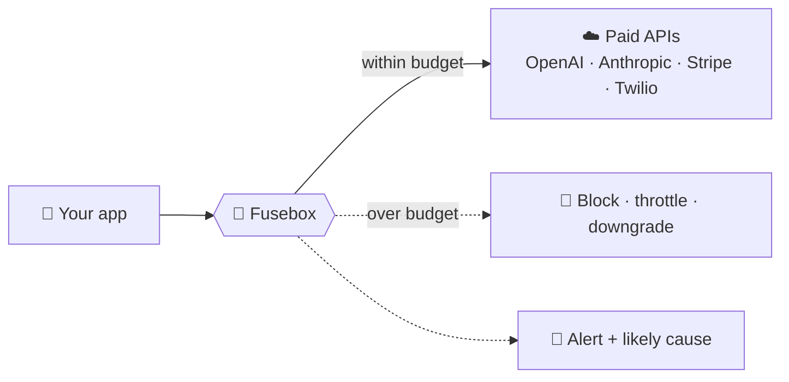
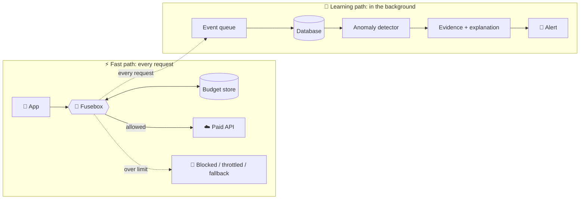

<div align="center">

# 🔌 Fusebox

**Stop runaway API spend in real time, and find out why it happened.**


</div>



---

## 💸 The problem

Paid APIs have no safety net. A bug can burn thousands of dollars overnight, and you find out when the invoice arrives.

| | What happens | The damage |
|---|---|---|
| 🔁 **Runaway retries** | A nightly job retries failed LLM calls in a tight loop | ~**$4,300** by morning |
| 🤖 **Agent loops** | An AI agent re-calls a tool, re-sending a growing context | Cost climbs every turn |
| 🚪 **Unthrottled endpoint** | No per-user limit on `/api/summarize`; one script fires 10,000 calls | You pay for all of them |
| 📈 **Prompt bloat** | A deploy breaks truncation: 2k → 40k tokens per call | Same traffic, ~**20x** bill |
| 🔀 **Silent model swap** | A config change moves a feature to a flagship model | **10–30x** price per token |
| 🐌 **Slow upstream** | The API takes 30s instead of 2s; requests pile up | Your own service goes down |

<sub>Figures are illustrative.</sub>

**Why not the vendor dashboard?** Billing dashboards and spend limits work per account or project. They can't say "customer A gets $50/hour," they can't block a single request in real time, and they won't tell you *why* costs jumped.

---

## ✨ What Fusebox does

- 🛑 **Enforces** per-tenant and per-endpoint budgets and rate limits before the request is sent: block it, throttle it, or fall back to a cheaper option
- 💲 **Prices every call**: token-aware for LLMs, per-call or per-unit for SMS, maps and payments
- ⚡ **Protects latency** with timeouts, retries and circuit breakers
- 📊 **Shows** spend, tokens and latency by tenant, endpoint and model
- 🔍 **Detects** cost and latency anomalies
- 🧠 **Explains** the likely cause in plain English, then alerts your team

---

## ▶️ Try it

One command starts the gateway, Redis, Postgres, Prometheus, Grafana and a small demo app that plays the paid API, sends traffic, and misbehaves on purpose.

```bash
docker compose up --build
```

| Open | What you'll find |
|---|---|
| **[localhost:3000](http://localhost:3000)** | 📊 Grafana: traffic, latency, spend by tenant, budgets filling up, anomalies with their diagnosis |
| **[localhost:8080/admin/swagger](http://localhost:8080/admin/swagger)** | 🧰 Admin API: tenants, budgets, keys, prices (admin key: `demo-admin-key`) |
| **[localhost:8081/alerts](http://localhost:8081/alerts)** | 🔔 The alerts Fusebox delivered |

After roughly ten minutes the small tenant uses up its budget and starts being refused (budgets reset on the hour). After about twelve, the other tenant starts calling ten times as often, over and over with the same prompt. Watch Fusebox notice, explain it, and send the alert. After about twenty-four, the stand-in vendor goes down for three minutes: Fusebox cuts it off, refuses calls at once instead of letting them hang, and pages.

<sub>Everything in the demo stack uses throwaway passwords. It shows the system working and is not a production setup.</sub>

---

## ⚙️ How it works

Two paths, kept apart on purpose: a **fast path** that decides before each call, and a **learning path** that never slows a call down.



1. **Check:** your app calls Fusebox, which checks the tenant's budget and rate limit and reserves the estimated cost, so concurrent requests can't overshoot.
2. **Decide:** allow, throttle, fall back to a cheaper option, or block.
3. **Forward:** the call goes out through a circuit breaker for that vendor, so a vendor that is down gets refused at once instead of hanging every caller. Calls are never retried, so one is never billed twice. Streaming responses pass straight through.
4. **Settle:** once the response is done, the real cost replaces the estimate.
5. **Record:** every request is queued and saved off the hot path.
6. **Detect and explain:** a background detector compares recent traffic with its baseline. When something spikes, Fusebox works out what changed (payload size, repeated requests, model mix, volume) and alerts with a plain-English cause.

---

## 🧭 Key design decisions

Each decision has a full write-up in [docs/adr](docs/adr/README.md). The overall design is in [docs/architecture.md](docs/architecture.md).

| Decision | Options considered | Choice | Why |
|---|---|---|---|
| **Interception** | YARP gateway · Envoy / Kong / LiteLLM · client SDK | **YARP gateway** (.NET) | Easy request rewriting for fallbacks, streams responses straight through, no extra network hop, one language to own and test |
| **Budget and limit state** | Redis · in-process memory with DB sync | **Redis** with atomic scripts, config refreshed from Postgres every few minutes | One shared budget across instances and no race-condition overshoot. Postgres stays the source of truth for config |
| **Recording requests** | In-process queue · Kafka / RabbitMQ | **In-process queue** with a background batch writer | Recording never adds latency. Budgets live in Redis, so a crash loses a second of history, not enforcement |
| **Telemetry storage** | PostgreSQL · TimescaleDB · ClickHouse | **PostgreSQL** with partitions and rollup tables | One standard database for config, alerts and telemetry. Enough for the target scale, and TimescaleDB is the upgrade path |
| **Anomaly detection** | Statistics · machine learning · LLM | **Statistics** (baseline, seasonality, noise gates) | Works from day one, explains itself, and is deterministic to test. ML can run later as a benchmarked challenger |
| **Root-cause analysis** | Rules only · LLM only · hybrid | **Hybrid:** code finds the facts, an LLM explains them | Exact numbers, nothing invented, validated output, and a template fallback if the LLM fails |
| **Alerting** | Slack webhook · outbox + channels · Alertmanager · PagerDuty | **Durable alert table**, PagerDuty for critical, Slack for the rest, plus a heartbeat | Pages the on-call engineer, retries until confirmed, no duplicates, and notices if Fusebox itself dies |
| **Budget store down** | Fail-closed · fail-open · degraded fail-open | **Fail-open, degraded:** local limiter, time cap, instant alert. Routes can opt into fail-closed | Doesn't take your apps down, and spend stays bounded |
| **Visibility** | Grafana + OpenTelemetry · custom dashboard | **Grafana + OpenTelemetry**, plus an admin API | Days instead of weeks, so effort goes into the gateway. Per-tenant detail comes from Postgres rollups |
| **LLM cost** | Provider usage + reservation · pre-flight estimate · hybrid | **Hybrid:** reserve the worst case, settle with real usage, price catalog with per-tenant discounts and negotiated rates, checked against vendor statements | Matches the bill, stays race-safe, and handles negotiated discounts |

---

## 📏 What it costs and how well it works

| | Measured | Details |
|---|---|---|
| ⏱️ **Time added to a call** | under **1 ms** at the median (budgets in memory); with Redis, two Redis round trips more | [Gateway overhead](docs/benchmarks/gateway-overhead.md), including what was not measured |
| 🔎 **Time to notice a fault** | **5 minutes** for a cost, volume, error or latency jump; slow drifts are missed | [Anomaly detection](docs/benchmarks/anomaly-detection.md), including the cases it fails |

These were measured on a single laptop, and both pages say where the numbers stop being reliable.

---

## 🤝 Contributing

Contributions are welcome. [CONTRIBUTING.md](CONTRIBUTING.md) covers how to build and test it, how the code is laid out, and what a change needs to be accepted.

## 📄 License

[MIT](LICENSE)
