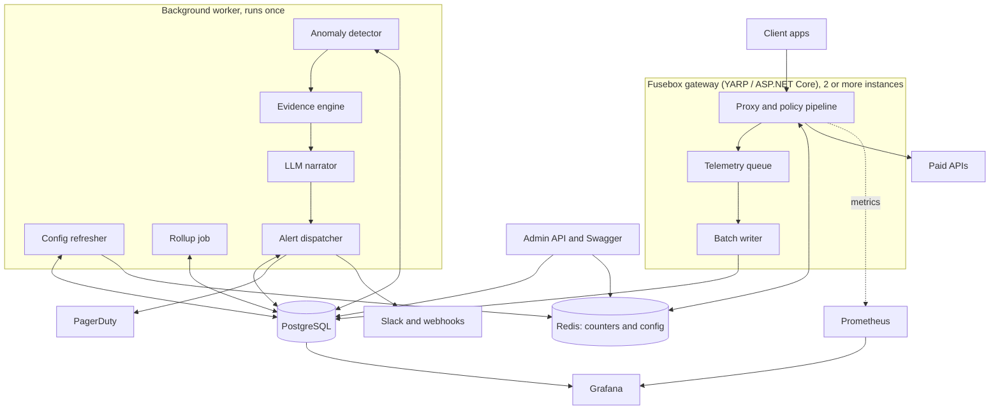
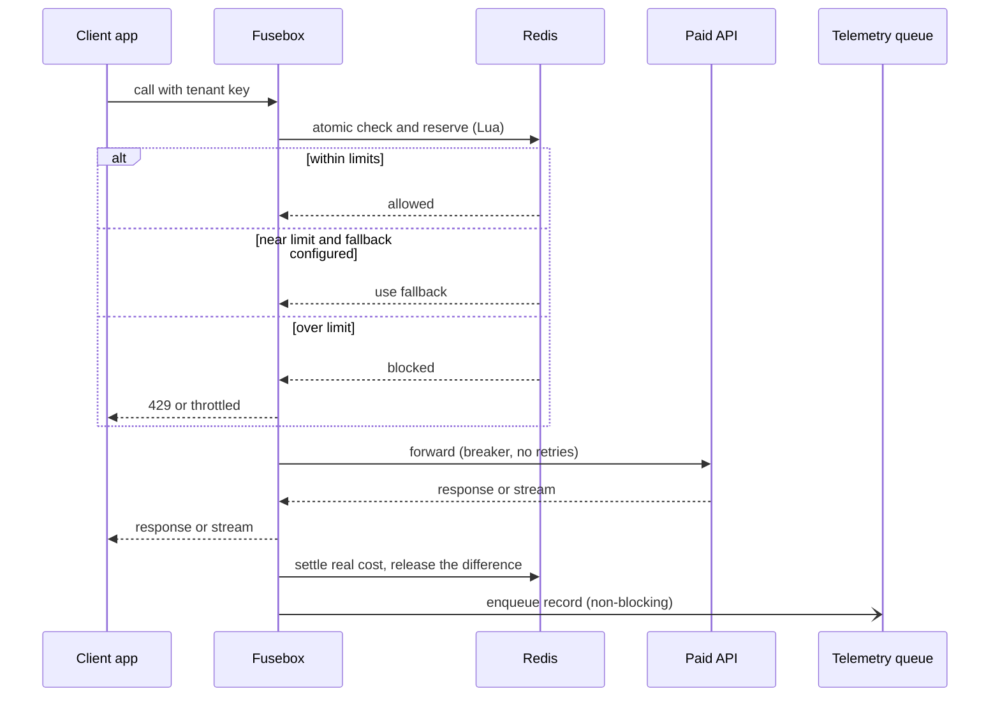
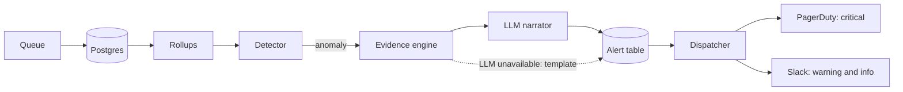

# Fusebox architecture

Fusebox is an outbound API gateway. Client apps send calls to paid third-party APIs through it. It enforces budgets and limits in real time, records what happened, detects anomalies and explains them.

The reasoning behind each choice is in the [decision records](adr/README.md).

## Goals

- Bound worst-case spend, even with concurrent requests and several gateway instances.
- Add minimal latency to the request path. Recording never adds any.
- Make every guardrail decision explainable and testable.
- Fail in a defined, bounded way when its own dependencies fail.
- Run with a single `docker compose up`.

## Non-goals

- Not a billing or invoicing system. Vendor invoices remain the source of truth.
- Not a general-purpose API gateway for incoming user traffic (no end-user auth, WAF or mTLS).
- Not a replacement for vendor-side hard spend caps, which should still be set as a backstop.

## Components

| Component | Responsibility |
|---|---|
| **Proxy and policy pipeline** | Authenticates the tenant key, checks and reserves budget, decides the action, forwards the call, settles the real cost |
| **Telemetry queue and batch writer** | Hand-off of request records off the hot path, and bulk saves to Postgres |
| **Config refresher** | Reloads config (limits, budgets, price catalog, policies) from Postgres into Redis every few minutes |
| **Rollup job** | Maintains per-minute and per-hour totals |
| **Anomaly detector** | Compares recent windows against baselines |
| **Evidence engine** | Ranks which cost factors changed |
| **LLM narrator** | Turns the evidence into a validated plain-English explanation, advisory only |
| **Alert dispatcher** | Sends pending alerts with retries and dedupe |
| **Admin API** | Manages tenants, budgets, keys and prices, and lists open anomalies and alerts. Changes go to Postgres and reach every instance through the catalog reload |

## Request path

The only added work on the request path is the Redis check (about 0.3 ms) and the response pass-through. Recording is a non-blocking hand-off.

## Learning path

## Route types and actions

Each route is either an LLM route or a flat-price route. The type decides how cost is computed and which actions are available.

| | LLM route | Flat-price route (SMS, maps, payments) |
|---|---|---|
| **Cost** | Tokens by kind × rate, from vendor-reported usage | Price table: count × unit price, known before the call |
| **Reservation and settlement** | Yes | No, cost is known up front |
| **Actions** | Allow, block, throttle, fall back to a cheaper model, alert only | Allow, block, throttle, alert only. Fallback only if one is configured (for example a cached result or a second vendor) |
| **Anomaly signals** | Volume, spend, repeated requests, errors, latency, tokens per request, model mix | Volume, spend, repeated requests, errors, latency |

## Failure behavior

| Failure | Behavior |
|---|---|
| **Redis down or slow** | Degraded fail-open: per-instance local limiter at a fraction of normal rate, last-known config, then fail-closed after a time cap. Critical alert. Spend is reconciled afterward. Routes can opt into strict fail-closed |
| **Postgres down** | Requests keep flowing. The queue buffers, and if it fills, records are dropped and counted. Config refresh and alert persistence pause |
| **Paid API slow or failing** | A circuit breaker per vendor: after repeated failures calls are refused at once, holding no budget, with one test call now and then. Critical alert when it opens, resolved when it closes. Calls are never retried, because a call the vendor already started would be billed twice |
| **Telemetry queue full** | New records dropped and counted. A request is never blocked |
| **LLM narrator down or invalid output** | Alert is sent with a templated explanation |
| **Alert channel down** | Alerts stay `pending` and are retried with backoff until confirmed |
| **Fusebox itself down** | The external heartbeat monitor alerts when pings stop |

## Scaling and multiple instances

- **Gateway instances are stateless.** Run at least two behind a load balancer. Budgets are shared through Redis, and each instance has its own telemetry queue and writer.
- **Background jobs run once.** The config refresher, rollup job, detector and alert dispatcher must not be duplicated. Run them in a separate worker process, or take a database lock so only one instance runs them.
- **Rough capacity.** Millions of calls a day is a few hundred requests a second at peak. What matters more is open connections: slow and streaming LLM calls hold a connection, so memory and connection limits are the tuning points. A load test will give the real numbers, and those are published rather than assumed.
- **Past roughly 10,000 requests a second,** expect Redis sharding, a broker in place of the in-process queue and a dedicated analytics store. Each is a documented upgrade path.

## Extension points

| Interface | Purpose | Default | Possible alternatives |
|---|---|---|---|
| `IEnforcementStore` | Budget and limit state | Redis | In-memory for tests and single-node dev |
| `ITelemetrySink` | Off-path record hand-off | In-process queue | Broker or outbox |
| `ITelemetryStore` | Telemetry storage and queries | PostgreSQL | TimescaleDB, ClickHouse |
| `IAnomalyDetector` | Detection method | Statistical | ML as a shadow challenger |
| `INotifier` | Alert delivery | PagerDuty, Slack, webhook | Teams, email, Opsgenie |
| Usage extractor (per vendor) | Read token usage from responses and streams | OpenAI-style, Anthropic | One class per new vendor |

## Data sketch

| Table | Contents |
|---|---|
| `tenants` | Tenant id, name, API key hash, failure-mode policy |
| `routes` | Route, vendor, type (LLM or flat-price), allowed actions, fallback target |
| `budgets` | Per tenant and route limits and windows |
| `price_catalog` | Vendor list prices, effective-dated, with per-account overrides |
| `requests` | Raw request records, partitioned by day, kept about 30 days |
| `rollups_minute`, `rollups_hour` | Pre-computed totals by tenant, endpoint and model, kept a year or more |
| `alerts` | Fingerprint, severity, status (`pending`, `sent`, `resolved`), channel, timestamps |

## Security and privacy

- Tenant API keys are stored as hashes and never logged.
- Prompts and response bodies are not stored. Only metadata and token counts are recorded.
- Only aggregated, PII-free numbers are sent to the LLM narrator.
- Secrets (vendor keys, webhook URLs, PagerDuty routing keys) come from configuration or a secrets store, not from the repository.

## Testing and proof

- Unit tests for the Lua budget script, price calculation, detector gates and alert dedupe.
- Streaming and client-disconnect tests for the proxy.
- A concurrent-load test showing zero budget overshoot.
- A replay benchmark for anomaly detection with injected faults.
- A published latency benchmark: added p99 latency and throughput on one instance.
- A chaos demo: kill Redis, show degraded serving and the alert, restore and show reconciliation.
